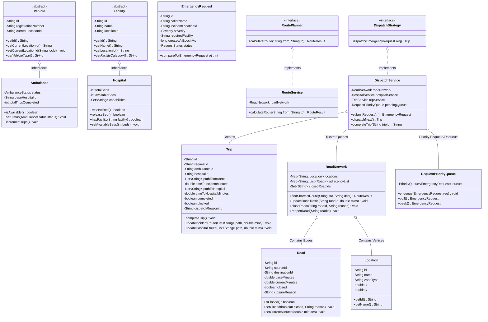

# Project Architecture & Technical Report
## Nalam Nagar Emergency Ambulance Dispatch & Route Optimization System

---

### 1. System Overview
**Nalam Nagar Dispatch System** is a high-reliability emergency coordination platform designed for a fictional municipality. It features:
- **Core Engine**: Pure Java 17, framework-free object-oriented design and classical data structures.
- **REST API Layer**: Embedded Sun/JDK `HttpServer` communicating via JSON on `http://localhost:5000`.
- **Frontend Console**: React (Vite) interface styled under the **Calm Municipal Operations Desk** design language on `http://localhost:5173`.
- **Console Mode**: Standalone menu-driven CLI running directly in the terminal via `ConsoleApp.java`.

---

### 2. UML Architecture & Class Diagram

---

### 3. Verification & Limitations

#### Runtime Limitations
1. **In-Memory Volatility**: The system operates entirely in heap memory per case study instructions. Reloading the application or invoking `/api/reset` re-seeds the simulation from `DataLoader.java`.
2. **Fixed Graph Dimensions**: 14 named municipal locations with 25 primary bi-directional segments (50 directed edges).
3. **Discrete Node Movement**: Fleet vehicles move instantly between graph nodes upon trip confirmation and completion, reflecting operational abstractions rather than real-time continuous GPS telemetry.
